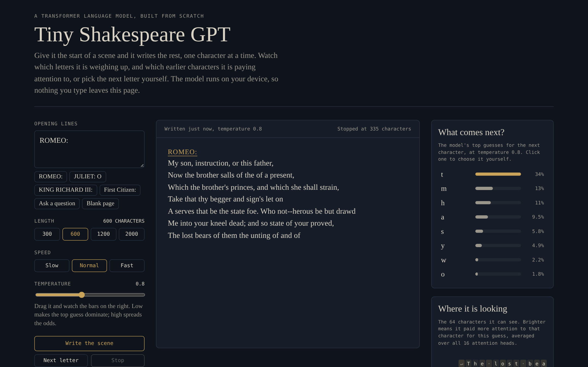

# GPT from Scratch

A small GPT language model built from first principles in PyTorch and trained on Shakespeare's plays. It writes new scenes one character at a time, and it runs live in the browser, where you can watch which characters it is weighing up and which earlier characters it is paying attention to.

**[Try the live demo](https://raiyaan-eight.vercel.app/gpt/)**

Built by following Andrej Karpathy's YouTube lecture [Let's build GPT: from scratch, in code, spelled out](https://youtu.be/kCc8FmEb1nY), then extended with a JavaScript port of the model and an interactive browser demo.



## Highlights

- **Every Transformer component written by hand:** attention heads, causal mask, multi-head attention, feed-forward layers, residual connections and LayerNorm. No `nn.Transformer`, no pretrained weights.
- **Trained from scratch** on the 1.1M-character Tiny Shakespeare dataset. The small model (0.82M parameters) trains in 10 minutes on a laptop CPU.
- **Runs in the browser:** the forward pass is ported to plain JavaScript, with a key/value cache. Its outputs match PyTorch to within 0.000003.
- **Shows its thinking:** the demo shows live next-character probabilities, an attention map over the last 64 characters, and a step mode where you pick the next character yourself.

## Results

| Model | Parameters | Validation loss | Hardware | Training time |
|---|---|---|---|---|
| Random guessing | 0 | 4.17 | | |
| Bigram baseline (`bigram.py`) | 4,225 | 2.49 | CPU | ~10 s |
| **GPT, `small` config** | **816,705** | **1.60** | 2-core CPU | 10 min |
| GPT, `full` config | 10.8M | ~1.48 (lecture result) | GPU | ~30-60 min on a Colab T4 |

Loss is cross-entropy over the 65-character vocabulary (lower is better). The full training log is in [`results/train_log.txt`](results/train_log.txt).

### Characters vs byte-pair encoding

Loss per token can't be compared across tokenizers, because a BPE token is about two characters. `evaluate.py` scores every token of the validation split once and reports **bits per character**, which can. Both models use the `small` config and 5,000 training steps on a 2-core CPU; they differ only in the tokenizer.

| Tokenizer | Vocab | Parameters | Chars/token (val) | Context | Loss/token | **Bits/char** |
|---|---|---|---|---|---|---|
| Characters | 65 | 816,705 | 1.00 | 64 chars | 1.613 | **2.327** |
| BPE (`--tokenizer bpe`) | 512 | 931,584 | 1.88 | ~120 chars | 2.834 | **2.177** |

The BPE model needs 6.4% fewer bits per character. Part of that comes from seeing about twice as much text in its 64-token window, and it also has 14% more parameters (its embedding and output layers are bigger). Its training log is in [`results/train_log_bpe.txt`](results/train_log_bpe.txt).

### Learning-rate schedule

`train.py --lr-schedule cosine` warms the learning rate up over the first 100 steps and then lowers it along a cosine curve to a tenth of its peak by the last step. Three runs of the `small` config with the current code, 5,000 steps each on a 2-core CPU, scored with `evaluate.py` on the full validation split:

| Run | Learning rate | Grad clip | Loss/token | **Bits/char** | Training time |
|---|---|---|---|---|---|
| Constant (the default) | 1e-3 every step | off | 1.6225 | **2.341** | 12.0 min |
| Warmup + cosine decay | 1e-5 -> 1e-3 -> 1e-4 | off | 1.5756 | **2.273** | 11.7 min |
| Warmup + cosine decay, clipped | 1e-5 -> 1e-3 -> 1e-4 | 1.0 | 1.5755 | **2.273** | 11.7 min |

The schedule takes 2.9% off the bits per character for the same number of steps and no extra compute. Clipping the gradient norm to 1.0 made no measurable difference here: the average norm before clipping stayed between 0.96 and 1.14 for the whole run, and the losses track the unclipped run closely at every eval. The cosine run's training log is in [`results/train_log_cosine.txt`](results/train_log_cosine.txt). (The committed checkpoint scores 2.327 with a constant rate; it was trained before the attention heads were batched, which changed the random starting weights, so the constant run above is the like-for-like baseline.)

A sample from the small model, given the prompt `ROMEO:`:

```
ROMEO:
My son, instruction, or this father,
Now the brother salls of the of a present,
Which the brother's princes, and which she shall strain,
Take that thy begger and sign's let on
```

It has learned the play format, line lengths, punctuation and many real words from raw characters alone. The meaning does not hold together, which is expected at this size (see [Limitations](#limitations)).

## Quick start

```bash
pip install -r requirements.txt

python sample.py --prompt "ROMEO:" --temperature 0.8   # use the trained model
python bigram.py                                       # baseline, ~10 seconds
python train.py --config small                         # train the GPT on CPU, ~10 minutes
```

The dataset downloads automatically on first run, and the trained small model is included at `checkpoints/ckpt.pt`.

### More options

```bash
python train.py --config full --device cuda --out checkpoints/full   # 10.8M-parameter model on a GPU
python train.py --data my_text.txt --out checkpoints/mine            # train on your own text
python train.py --config small --n-layer 6 --max-iters 8000          # override any hyperparameter
python train.py --config small --tokenizer bpe --out checkpoints/bpe # byte-pair encoding instead of characters
python train.py --config small --max-iters 5000 --lr-schedule cosine --out checkpoints/cosine   # warmup + cosine decay
python train.py --config small --lr-schedule cosine --warmup-iters 200 --min-lr 5e-5 --grad-clip 1.0
python sample.py --tokens 1000 --top-k 20 --num-samples 3
python sample.py --tokens 5000 --kv-cache                             # key/value cache: 2-9x faster sampling on CPU
python evaluate.py checkpoints/ckpt.pt checkpoints/bpe/ckpt.pt       # bits per character on the validation split
```

`--tokenizer bpe` learns a byte-pair encoding from the training text (512 tokens by default, set with `--bpe-vocab-size`) and stores it in the checkpoint, so `sample.py` and `app.py` pick it up automatically. On Tiny Shakespeare, 512 BPE tokens cover 1.94 characters each on average, so a 64-token context sees about twice as much text. `web/tokenizer.js` has both tokenizers in JavaScript, giving exactly the same ids as `tokenizer.py`:

```js
// the state tokenizer.py saves: {type: "bpe", merges: [[a, b], ...]} or {type: "char", chars: [...]}
const tok = createTokenizer(state);
const ids = tok.encode("ROMEO:\nWhat light");  // same ids as the Python tokenizer
tok.decode(ids);                               // "ROMEO:\nWhat light"
const d = tok.decoder();                       // for text written one token at a time:
ids.map(id => d.push(id)).join("");            // holds back a character split across tokens
```

`--lr-schedule cosine` ramps the learning rate up linearly for `--warmup-iters` steps (100 by default), then follows half a cosine from `--learning-rate` down to `--min-lr` (a tenth of it by default) at the last step. `--grad-clip N` rescales all the gradients together whenever their combined norm is above N. Both are off by default, so the default command trains exactly as before. With either one on, the progress lines also show the learning rate and the average gradient norm, and the checkpoint records the settings (`lr_schedule`, `warmup_iters`, `grad_clip`, `learning_rate`).

`evaluate.py` takes any number of checkpoints and prints a table with loss per token, bits per token and bits per character on the full validation split (the last 10% of the text). `--stride 32` uses overlapping windows so every token after the first window gets at least 32 tokens of context; this lowers the numbers a little and takes twice as long.

To train the full model on a free GPU, open [`train_colab.ipynb`](train_colab.ipynb) in Google Colab, switch the runtime to a T4 GPU, and run every cell.

### Web app and browser demo

```bash
pip install gradio
python app.py                       # Gradio app at http://127.0.0.1:7860
python app.py --ckpt checkpoints/bpe/ckpt.pt   # the app with a BPE model (or set GPT_CKPT)

python export_web.py                # rebuild docs/index.html from checkpoints/ckpt.pt
python export_web.py --ckpt checkpoints/bpe/ckpt.pt --out docs/bpe.html   # the same page for a BPE model
```

The app rebuilds whichever tokenizer the checkpoint was trained with. The length slider counts characters for both, so a BPE model gets there in about half as many steps, and generated tokens go through a streaming decoder (`tokenizer.decoder()`), so a character whose bytes are split across two tokens only appears once it is complete. The character model drops prompt characters it doesn't know; the BPE model reads raw bytes and keeps the prompt as typed.

The exporter stores the checkpoint's tokenizer in the page next to the weights, and `web/engine.js` rebuilds it with `web/tokenizer.js`, so character and BPE checkpoints both run in the browser. The page labels guesses and attention cells with each token's text (` the` shows as `·the`) and writes generated tokens through a streaming decoder, so a character split across two byte-level tokens never shows up as U+FFFD.

The page's wording and spec table come from the checkpoint too (`page_text` in `export_web.py`). A BPE page talks about tokens instead of characters, gives its context window in characters as well as tokens, and shows its bits per character, measured on the validation split when it exports (`--data` points at the training text). Its attention strip flows like text, so a long token such as `·Gloucester` gets a wide cell instead of being cut off. The training row is built from what `train.py` saves (steps, minutes and hardware), or set it with `--training "5,000 steps, 10 min, 2-core CPU"`.

[`docs/bpe.html`](docs/bpe.html) is the BPE model from the comparison above (512 tokens, 931,584 parameters), built this way. Its checkpoint isn't in git, so to rebuild it, train it first with `python train.py --config small --tokenizer bpe --max-iters 5000 --eval-interval 500 --out checkpoints/bpe`.

Checkpoints saved before the attention heads were batched (one key/query/value layer per head) still load: `GPT.load_state_dict` converts them to the fused layout, and `web/engine.js` accepts either layout.

`--kv-cache` keeps each token's attention keys and values instead of rerunning the whole context window for every new token, so a step costs one position of compute. On a 2-core CPU, sampling 1,000 tokens went from 1.70 to 0.78 ms per token for the small model (2.2x) and from 28.9 to 3.2 ms for the `full` architecture (9.2x, random weights, since no full checkpoint is trained yet). The samples are exactly the same until the context window fills. After that, because the position embeddings are absolute, the cache can't slide along with the text, so it starts again from the newest half of the window, the same rule the browser engine uses. The model then sees 32 to 64 characters instead of always 64; on the validation split that scores 2.272 bits per character against 2.281 for the full sliding window, so the shorter context costs nothing on this model.

`docs/index.html` and `docs/bpe.html` are single static files with the weights embedded, so they can be opened locally or served with GitHub Pages.

### Tests

```bash
pip install pytest
python -m pytest tests
```

The tests check that the batched attention gives the same outputs as the original per-head version, that `evaluate.py` scores every validation token exactly once (and matches a one-token-at-a-time reference), that the learning-rate schedule warms up, decays to its floor and stays constant when it is off (and that `train.py` runs end to end with it and gradient clipping), that `checkpoints/ckpt.pt` still loads, that the key/value cache gives the same logits as a full forward pass (and the same window rule, step by step, as the browser engine), that the JavaScript engine matches PyTorch for both weight layouts and both tokenizers (including encoding prompts and streaming text back), that `export_web.py` builds a page from a BPE checkpoint that talks about tokens (and rebuilds the committed `docs/index.html` byte for byte, with its character wording unchanged), and that the JavaScript tokenizers give the same chunks, ids and decoded text as the Python ones, on the whole of Tiny Shakespeare and on awkward Unicode (the JavaScript tests need Node.js and are skipped without it).

## How it works

```
characters -> token embedding + position embedding
           -> 4 x [ LayerNorm -> masked multi-head self-attention -> + residual
                    LayerNorm -> feed-forward (128 -> 512 -> 128)  -> + residual ]
           -> LayerNorm -> linear -> scores for the 65 possible next characters
```

| Component | File | Role |
|---|---|---|
| `CharTokenizer` | `tokenizer.py` | Maps each of the 65 characters to an integer and back |
| `BPETokenizer` | `tokenizer.py` | Byte-level byte-pair encoding written from scratch: starts from the 256 bytes and repeatedly merges the most frequent adjacent pair into a new token, never across word boundaries |
| `decoder()` | `tokenizer.py` | Streams generated ids as text: holds back the bytes of an unfinished multi-byte character, so text written token by token never shows a broken character; joined, its output is exactly `decode(ids)` |
| `split_text` | `data.py` | First 90% of the characters for training, last 10% for validation, split before tokenizing so every tokenizer is validated on the same text |
| `get_batch` | `data.py` | Samples random 64-character chunks; targets are the inputs shifted by one |
| `get_lr` | `train.py` | The learning rate for each step: constant, or a linear warmup followed by a cosine decay to a tenth of the peak; the training loop can also clip the gradient norm before each AdamW step |
| `MultiHeadAttention` | `model.py` | Causal self-attention with four 32-wide heads computed together: one `Linear(C, 3C)` makes every head's queries, keys and values, the heads become a batch axis, queries and keys score every earlier character (scaled by 1/sqrt(head_size)), a lower-triangular mask hides the future, softmax weights the values, and the heads are concatenated and projected |
| `FeedForward` | `model.py` | Per-character MLP with a 4x expansion and ReLU |
| `Block` | `model.py` | Attention then feed-forward, each with pre-LayerNorm and a residual connection |
| `GPT` | `model.py` | Embeddings, four blocks, output head, and `generate()` with temperature and top-k sampling |
| `KVCache`, `next_logits` | `model.py` | Keeps every layer's keys and values for the tokens already in the window, so `generate(use_cache=True)` feeds one new token per step; when the window is full it rebuilds the cache from the newest half, like the browser engine |
| `total_nll`, `evaluate_text` | `evaluate.py` | Slides the context window over the whole validation split, adds up -log p of every token once, and divides by the number of characters to get bits per character |
| `write` | `app.py` | The Gradio app's loop: samples one token at a time from any checkpoint and streams the text to the page until the requested number of characters is written |
| Browser engine | `web/engine.js` | The same forward pass in JavaScript, with a key/value cache; builds the checkpoint's tokenizer from the state the page embeds |
| `page_text` | `export_web.py` | Fills the demo page's wording and spec table from the checkpoint: characters or tokens, context in characters, parameters, training run, loss and bits per character |
| Browser tokenizers | `web/tokenizer.js` | Both tokenizers in JavaScript, built from the state a checkpoint saves; the chunk pattern spells out Python's whitespace set so the ids match exactly |

### Hyperparameters

| | `small` (trained) | `full` |
|---|---|---|
| Layers / heads | 4 / 4 | 6 / 6 |
| Embedding size | 128 | 384 |
| Context length | 64 | 256 |
| Batch size | 32 | 64 |
| Dropout | 0.1 | 0.2 |
| Learning rate (AdamW) | 1e-3 | 3e-4 |
| Schedule | constant (`--lr-schedule cosine` optional) | constant |
| Steps | 5,000 | 5,000 |

## Limitations

This is a character-level model trained on 1 MB of text, so it imitates the surface of Shakespeare rather than understanding it.

- It continues text; it cannot answer questions or follow instructions. A question is treated as the start of a script.
- It sees only the last 64 characters, so it loses track of speakers and topics after about a line.
- Its vocabulary is the 65 characters in the dataset. Most digits, symbols and emoji are unknown.

Models like ChatGPT use the same core architecture at a far larger scale, with subword tokens and further training on conversations and human feedback.

## Project structure

```
gpt-from-scratch/
├── model.py              GPT architecture and key/value cache
├── tokenizer.py          character-level and BPE tokenizers
├── data.py               dataset download, batching, device selection
├── bigram.py             baseline model
├── train.py              training loop, learning-rate schedule, evaluation, checkpointing
├── sample.py             text generation from a checkpoint (optionally with the key/value cache)
├── evaluate.py           bits per character on the full validation split
├── app.py                Gradio web app for character or BPE checkpoints (local or Hugging Face Spaces)
├── export_web.py         builds the browser demo from a checkpoint
├── web/
│   ├── engine.js         forward pass in JavaScript
│   ├── tokenizer.js      character and BPE tokenizers in JavaScript
│   └── template.html     browser demo page
├── docs/
│   ├── index.html        built browser demo (static, weights embedded)
│   ├── bpe.html          the same demo running the BPE model
│   └── DEVLOG.md         what changed and why, build by build
├── tests/                pytest tests for the model, tokenizers, checkpoint loading, the app and the JS engine
├── checkpoints/ckpt.pt   trained small model
├── results/              training logs and a full sample
├── assets/               screenshots
├── train_colab.ipynb     GPU training on Google Colab
└── requirements.txt
```

## Next steps

- [ ] Train the `full` configuration on a GPU and add the result
- [x] Batch all attention heads into one matrix multiply
- [x] Replace the character tokenizer with BPE
  - [x] Byte-level BPE tokenizer written from scratch, usable with `train.py --tokenizer bpe`
  - [x] Train a BPE model and compare it with the character model in bits per character (2.18 vs 2.33)
  - [x] Port the BPE tokenizer to the browser demo
    - [x] BPE and character tokenizers in JavaScript (`web/tokenizer.js`), matching Python id for id
    - [x] Export a BPE checkpoint to the page and show tokens instead of characters in the demo
      - [x] `export_web.py` and `web/engine.js` accept BPE checkpoints; the page labels tokens and streams multi-byte characters correctly
      - [x] Publish a BPE page (`docs/bpe.html`), with wording and an attention strip sized for multi-character tokens
  - [x] Run BPE checkpoints in the Gradio app (`app.py --ckpt`, with a streaming decoder for split characters)
- [ ] Train on a different dataset, such as Malay text
- [x] Key/value cache for `generate()` in PyTorch (`sample.py --kv-cache`)
- [x] Learning-rate warmup, cosine decay and gradient clipping (`train.py --lr-schedule cosine --grad-clip`; 2.273 vs 2.341 bits per character)

## Acknowledgements

Built by following Andrej Karpathy's YouTube lecture [Let's build GPT: from scratch, in code, spelled out](https://youtu.be/kCc8FmEb1nY), which follows [Attention Is All You Need](https://arxiv.org/abs/1706.03762) (Vaswani et al., 2017). The dataset is [Tiny Shakespeare](https://github.com/karpathy/char-rnn).

## License

[MIT](LICENSE) © 2026 Abdul Raiyaan
