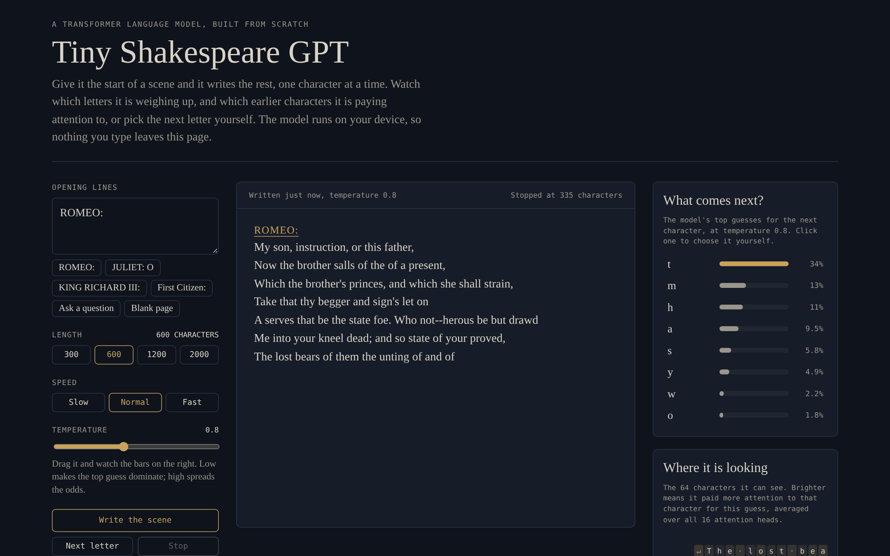

# GPT from Scratch

A small GPT language model built from first principles in PyTorch and trained on Shakespeare's plays. It writes new scenes one character at a time, and it runs live in the browser, where you can watch which characters it is weighing up and which earlier characters it is paying attention to.

**[Try the live demo](https://raiyaan-eight.vercel.app/gpt/)**

Built by following Andrej Karpathy's YouTube lecture [Let's build GPT: from scratch, in code, spelled out](https://youtu.be/kCc8FmEb1nY), then extended with a JavaScript port of the model and an interactive browser demo.



## Highlights

- **Every Transformer component written by hand:** attention heads, causal mask, multi-head attention, feed-forward layers, residual connections and LayerNorm. No `nn.Transformer`, no pretrained weights.
- **Trained from scratch** on the 1.1M-character Tiny Shakespeare dataset. The small model (0.82M parameters) trains in 10 minutes on a laptop CPU.
- **Runs in the browser:** the forward pass is ported to plain JavaScript, with a key/value cache. Its outputs match PyTorch to within 0.000003.
- **Shows its thinking:** the demo shows live next-character probabilities, an attention map over the last 64 characters, and a step mode where you pick the next character yourself.

## Results

| Model | Parameters | Validation loss | Hardware | Training time |
|---|---|---|---|---|
| Random guessing | 0 | 4.17 | | |
| Bigram baseline (`bigram.py`) | 4,225 | 2.49 | CPU | ~10 s |
| **GPT, `small` config** | **816,705** | **1.60** | 2-core CPU | 10 min |
| GPT, `full` config | 10.8M | ~1.48 (lecture result) | GPU | ~30-60 min on a Colab T4 |

Loss is cross-entropy over the 65-character vocabulary (lower is better). The full training log is in [`results/train_log.txt`](results/train_log.txt).

A sample from the small model, given the prompt `ROMEO:`:

```
ROMEO:
My son, instruction, or this father,
Now the brother salls of the of a present,
Which the brother's princes, and which she shall strain,
Take that thy begger and sign's let on
```

It has learned the play format, line lengths, punctuation and many real words from raw characters alone. The meaning does not hold together, which is expected at this size (see [Limitations](#limitations)).

## Quick start

```bash
pip install -r requirements.txt

python sample.py --prompt "ROMEO:" --temperature 0.8   # use the trained model
python bigram.py                                       # baseline, ~10 seconds
python train.py --config small                         # train the GPT on CPU, ~10 minutes
```

The dataset downloads automatically on first run, and the trained small model is included at `checkpoints/ckpt.pt`.

### More options

```bash
python train.py --config full --device cuda --out checkpoints/full   # 10.8M-parameter model on a GPU
python train.py --data my_text.txt --out checkpoints/mine            # train on your own text
python train.py --config small --n-layer 6 --max-iters 8000          # override any hyperparameter
python sample.py --tokens 1000 --top-k 20 --num-samples 3
```

To train the full model on a free GPU, open [`train_colab.ipynb`](train_colab.ipynb) in Google Colab, switch the runtime to a T4 GPU, and run every cell.

### Web app and browser demo

```bash
pip install gradio
python app.py                       # Gradio app at http://127.0.0.1:7860

python export_web.py                # rebuild docs/index.html from checkpoints/ckpt.pt
```

Checkpoints saved before the attention heads were batched (one key/query/value layer per head) still load: `GPT.load_state_dict` converts them to the fused layout, and `web/engine.js` accepts either layout.

`docs/index.html` is a single static file with the weights embedded, so it can be opened locally or served with GitHub Pages.

### Tests

```bash
pip install pytest
python -m pytest tests
```

The tests check that the batched attention gives the same outputs as the original per-head version, that `checkpoints/ckpt.pt` still loads, and that the JavaScript engine matches PyTorch for both weight layouts (the engine tests need Node.js and are skipped without it).

## How it works

```
characters -> token embedding + position embedding
           -> 4 x [ LayerNorm -> masked multi-head self-attention -> + residual
                    LayerNorm -> feed-forward (128 -> 512 -> 128)  -> + residual ]
           -> LayerNorm -> linear -> scores for the 65 possible next characters
```

| Component | File | Role |
|---|---|---|
| `CharTokenizer` | `tokenizer.py` | Maps each of the 65 characters to an integer and back |
| `get_batch` | `data.py` | Samples random 64-character chunks; targets are the inputs shifted by one |
| `MultiHeadAttention` | `model.py` | Causal self-attention with four 32-wide heads computed together: one `Linear(C, 3C)` makes every head's queries, keys and values, the heads become a batch axis, queries and keys score every earlier character (scaled by 1/sqrt(head_size)), a lower-triangular mask hides the future, softmax weights the values, and the heads are concatenated and projected |
| `FeedForward` | `model.py` | Per-character MLP with a 4x expansion and ReLU |
| `Block` | `model.py` | Attention then feed-forward, each with pre-LayerNorm and a residual connection |
| `GPT` | `model.py` | Embeddings, four blocks, output head, and `generate()` with temperature and top-k sampling |
| Browser engine | `web/engine.js` | The same forward pass in JavaScript, with a key/value cache |

### Hyperparameters

| | `small` (trained) | `full` |
|---|---|---|
| Layers / heads | 4 / 4 | 6 / 6 |
| Embedding size | 128 | 384 |
| Context length | 64 | 256 |
| Batch size | 32 | 64 |
| Dropout | 0.1 | 0.2 |
| Learning rate (AdamW) | 1e-3 | 3e-4 |
| Steps | 5,000 | 5,000 |

## Limitations

This is a character-level model trained on 1 MB of text, so it imitates the surface of Shakespeare rather than understanding it.

- It continues text; it cannot answer questions or follow instructions. A question is treated as the start of a script.
- It sees only the last 64 characters, so it loses track of speakers and topics after about a line.
- Its vocabulary is the 65 characters in the dataset. Most digits, symbols and emoji are unknown.

Models like ChatGPT use the same core architecture at a far larger scale, with subword tokens and further training on conversations and human feedback.

## Project structure

```
gpt-from-scratch/
├── model.py              GPT architecture
├── tokenizer.py          character-level tokenizer
├── data.py               dataset download, batching, device selection
├── bigram.py             baseline model
├── train.py              training loop, evaluation, checkpointing
├── sample.py             text generation from a checkpoint
├── app.py                Gradio web app (local or Hugging Face Spaces)
├── export_web.py         builds the browser demo from a checkpoint
├── web/
│   ├── engine.js         forward pass in JavaScript
│   └── template.html     browser demo page
├── docs/
│   ├── index.html        built browser demo (static, weights embedded)
│   └── DEVLOG.md         what changed and why, build by build
├── tests/                pytest tests for the model, checkpoint loading and the JS engine
├── checkpoints/ckpt.pt   trained small model
├── results/              training log and a full sample
├── assets/               screenshots
├── train_colab.ipynb     GPU training on Google Colab
└── requirements.txt
```

## Next steps

- [ ] Train the `full` configuration on a GPU and add the result
- [x] Batch all attention heads into one matrix multiply
- [ ] Replace the character tokenizer with BPE (`tiktoken`)
- [ ] Train on a different dataset, such as Malay text

## Acknowledgements

Built by following Andrej Karpathy's YouTube lecture [Let's build GPT: from scratch, in code, spelled out](https://youtu.be/kCc8FmEb1nY), which follows [Attention Is All You Need](https://arxiv.org/abs/1706.03762) (Vaswani et al., 2017). The dataset is [Tiny Shakespeare](https://github.com/karpathy/char-rnn).

## License

[MIT](LICENSE) © 2026 Abdul Raiyaan
